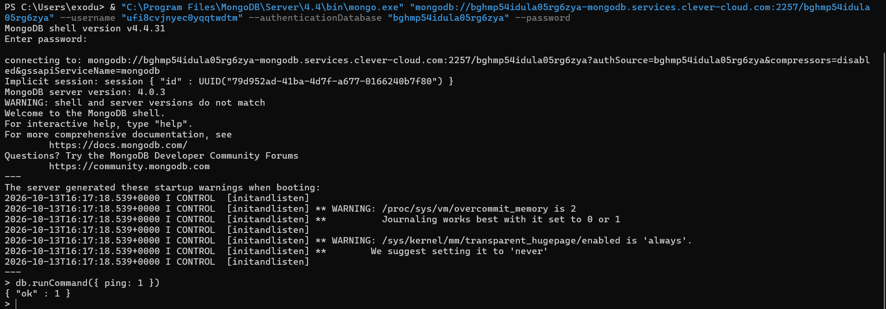
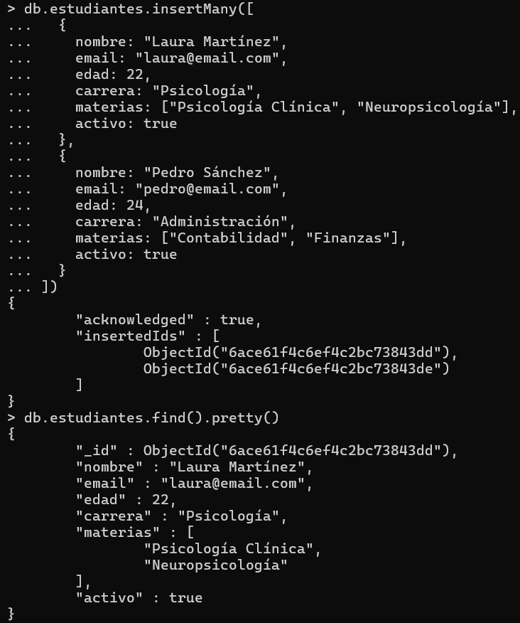
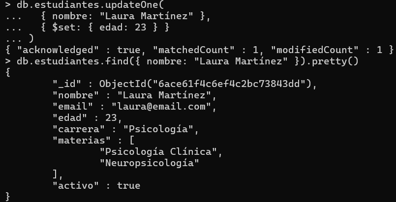
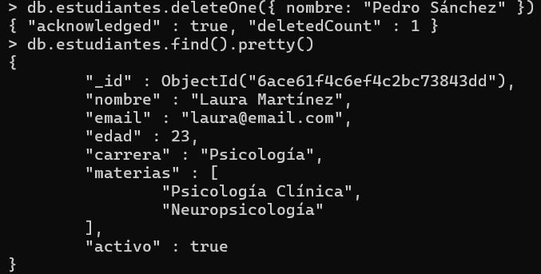
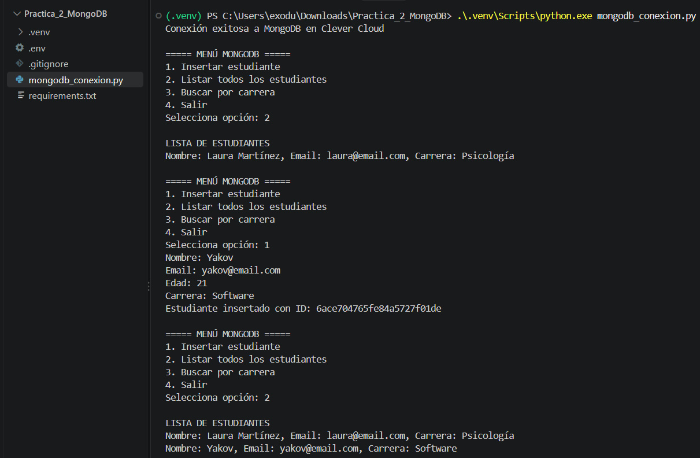

# Práctica 2: MongoDB en Clever Cloud

## Descripción

Implementación de una base de datos NoSQL MongoDB alojada en Clever Cloud, realizando operaciones CRUD desde MongoDB Shell y mediante una aplicación desarrollada en Python.

## Tecnologías utilizadas

- MongoDB 4.0.3
- MongoDB Shell 4.4.31
- Clever Cloud
- Python 3.11
- PyMongo
- Visual Studio Code

## Funcionalidades

- Conexión remota a MongoDB.
- Inserción de estudiantes.
- Consulta de documentos.
- Actualización de registros.
- Eliminación de estudiantes.
- Aplicación Python con menú interactivo.

## Evidencias de la práctica

### 2. Conexión exitosa



### 3. Inserción y consulta



### 4. Actualización



### 5. Eliminación



### 6. Aplicación Python



## Instalación y ejecución

Instalar las dependencias:

```powershell
pip install -r requirements.txt
```

Crear un archivo `.env` con las variables `MONGO_URI` y `MONGO_DB` correspondientes a una instancia propia de MongoDB.

Ejecutar:

```powershell
python mongodb_conexion.py
```

## Informe

[Ver informe completo en PDF](informe.pdf)

## Conclusión

Se implementó una conexión remota con MongoDB en Clever Cloud y se realizaron operaciones CRUD utilizando MongoDB Shell y Python, comprendiendo las características principales de las bases de datos NoSQL.
